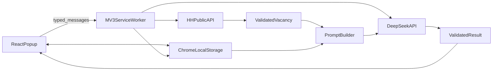

# План реализации HH-Hunter

## Технологические решения
- Основа: WXT + Vite + React + TypeScript в strict-режиме.
- UI: Tailwind CSS, локальные React-компоненты, Zustand только для общего состояния popup.
- Данные: `chrome.storage.local` через типизированный repository; Zod для входных данных, HH API и ответа DeepSeek.
- Фоновые операции: MV3 service worker и типизированные сообщения между popup и background.
- Тесты: Vitest для чистой логики; ручная smoke-проверка unpacked-расширения в Chrome/Edge.
- Ключ DeepSeek хранить локально с явным предупреждением пользователю. Web Crypto без внешнего секрета не обеспечивает настоящую защиту, поэтому не выдавать обфускацию за шифрование.

## Итерация 1 — Каркас и инфраструктура
- Инициализировать WXT React-проект и подключить TypeScript, Tailwind, ESLint/Prettier и Vitest.
- Создать entrypoints: [`entrypoints/popup/`](entrypoints/popup/), [`entrypoints/background.ts`](entrypoints/background.ts) и конфигурацию [`wxt.config.ts`](wxt.config.ts).
- Настроить минимальные MV3 permissions: `storage`, `activeTab`; host permissions только для HH API и DeepSeek API.
- Добавить базовые типы, Zod-схемы и единый формат ошибок в [`lib/schemas.ts`](lib/schemas.ts) и [`lib/types.ts`](lib/types.ts).
- Результат: расширение собирается, устанавливается unpacked и открывает пустой popup без ошибок.

## Итерация 2 — Навигация и локальное состояние
- Собрать оболочку popup с вкладками «Профиль», «Генератор», «Настройки API» и адаптировать интерфейс под ограниченный размер popup.
- Ввести Zustand-store для состояния текущей сессии и типизированный storage repository в [`lib/storage.ts`](lib/storage.ts).
- Реализовать загрузку, сохранение и миграцию версии локальных данных, чтобы будущие обновления схемы не ломали профиль.
- Результат: вкладки работают, данные переживают закрытие popup и перезапуск браузера.

## Итерация 3 — Профиль кандидата
- Реализовать поля имени, ссылки и достижений, валидацию URL, сохранение и превью первых 200 символов.
- Добавить background-команду импорта публичной страницы портфолио, очистку HTML и лимиты размера/таймаута.
- Для произвольных доменов запрашивать runtime-доступ через `optional_host_permissions`; не пытаться менять запрещённый браузером `User-Agent`.
- При CORS, авторизации, robots-защите или неинформативном HTML показывать textarea как штатный fallback.
- Результат: профиль сохраняется; доступная публичная страница импортируется, недоступная корректно переводит пользователя на ручной ввод.

## Итерация 4 — Импорт и нормализация вакансии
- Создать устойчивый парсер HH URL/ID и покрыть варианты query/hash/subdomain unit-тестами в [`lib/hh-url.test.ts`](lib/hh-url.test.ts).
- Реализовать вызов `GET https://api.hh.ru/vacancies/{id}` в [`lib/api/hh.ts`](lib/api/hh.ts), Zod-проверку ответа и маппинг в локальный `Vacancy`.
- Очищать HTML-описание, нормализовать навыки/опыт/занятость и ограничивать текст перед дальнейшей отправкой в LLM.
- Поддержать сканирование URL активной вкладки и ручную вставку ссылки; обработать 404, сеть, rate limit и неверный URL.
- Результат: обе точки входа показывают одну и ту же нормализованную карточку вакансии.

## Итерация 5 — Настройки и контракт генерации
- Реализовать форму стиля, длины и дополнительного фокуса с дефолтами из ТЗ.
- Вынести system/user prompt и безопасную подстановку данных в [`lib/prompts.ts`](lib/prompts.ts); явно отделить инструкции от недоверенного текста вакансии/портфолио для снижения prompt injection.
- Определить Zod-контракт `{ hidden_keys, unique_intersection, letter }`, правила длины и fallback-парсинг ответа модели.
- Добавить unit-тесты сборки промпта, ограничения контекста и валидации результата.
- Результат: из профиля, вакансии и настроек детерминированно формируется валидный запрос без обращения к DeepSeek.

## Итерация 6 — DeepSeek и полный сценарий генерации
- Реализовать настройку/проверку API-ключа и background-клиент DeepSeek в [`lib/api/deepseek.ts`](lib/api/deepseek.ts).
- Выполнять запрос только из service worker, задавать JSON-формат ответа, таймаут и понятную классификацию ошибок 401/429/5xx/invalid JSON.
- Связать полный поток: профиль → вакансия → настройки → генерация → валидированный результат.
- Сначала использовать обычный ответ со стадийным индикатором; streaming добавлять только если API действительно отдаёт полезные промежуточные данные, поскольку JSON нельзя надёжно отображать до завершения объекта.
- Результат: реальная вакансия и профиль дают три обязательных блока результата, а ошибки не уничтожают введённые данные.

## Итерация 7 — Результат и действия пользователя
- Создать [`components/ResultView.tsx`](components/ResultView.tsx): точка пересечения, редактируемое письмо и сворачиваемые скрытые ключи.
- Добавить копирование только текста письма, повторную генерацию с теми же параметрами, отмену активного запроса и открытие страницы вакансии/отклика.
- Предотвратить двойные запросы, показать длительность операции и сохранить ручные правки в рамках текущей сессии.
- Результат: завершён основной двухкликовый пользовательский сценарий из ТЗ.

## Итерация 8 — Надёжность, приватность и релизная сборка
- Проверить минимальность permissions, CSP, отсутствие ключа/PII в логах и отсутствие запросов на сторонние хосты помимо явно разрешённых.
- Добавить privacy-текст: какие данные локальны и что именно отправляется DeepSeek; подготовить иконки и store metadata.
- Покрыть критическую логику тестами: storage migrations, URL parser, HH mapper, prompt builder, DeepSeek schema/error handling.
- Выполнить acceptance-check по разделу 8 [`hh-hunter.tech-spec.md`](hh-hunter.tech-spec.md) в Chrome и Edge, собрать production ZIP через WXT.
- Результат: воспроизводимая релизная сборка и заполненный чек-лист готовности к Chrome Web Store.

## Поток данных

## Критерий завершения каждой итерации
- Сборка проходит без TypeScript и lint-ошибок.
- Новая чистая логика покрыта Vitest-тестами.
- Новый пользовательский сценарий проверен в unpacked Chrome extension.
- Разрешения и передаваемые данные не расширяются без необходимости.